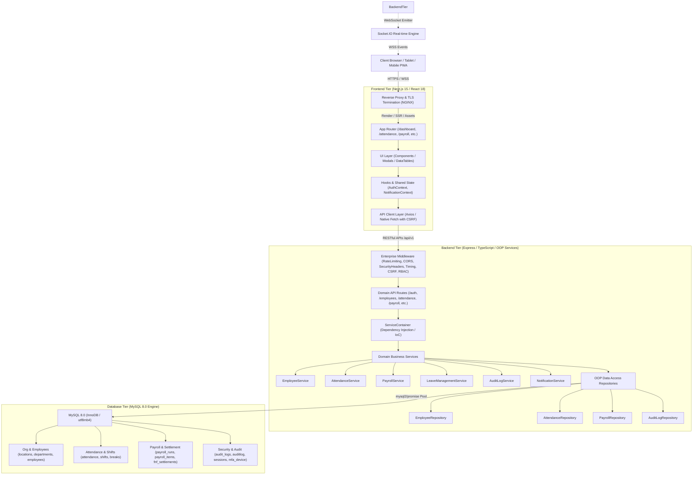

# BSC Textiles HRMS — Architecture & Scalable System Design

**Version:** 1.0.0 (Production Architecture)  
**System Type:** Multi-Store Enterprise Human Resource Management System (HRMS)  
**Locations:** Belagavi (HQ), Davanagere, Shivamogga, Bellary

---

## 1. High-Level Architecture Overview

BSC Textiles HRMS is organized as a decoupled, high-performance three-tier enterprise application:
1. **Frontend Tier (`frontend/`)**: Modern React 18 / Next.js 15 App Router providing responsive UI, state management, role-based dashboards, and real-time WebSocket feeds.
2. **Backend Tier (`backend/`)**: Modular Node.js / Express micro-service backend implementing Inversion of Control (IoC), domain-driven service architecture, OOP repositories, RFC-7807 error handling, and high-performance timing metrics.
3. **Database Tier (`database/`)**: Native MySQL 8.0 InnoDB persistence engine with connection pooling, transactional integrity, sub-second `DATETIME(3)` temporal tracking, and zero ORM overhead.



---

## 2. Directory Layout & Layer Responsibilities

The codebase strictly isolates responsibilities into three primary workspaces:

```text
BSC-Textiles-HRMS/
├── frontend/                     # Tier 1: User Interface & Presentation
│   ├── public/                   # Static assets, fonts, icons, manifest
│   ├── src/
│   │   ├── app/                  # Next.js App Router (pages and layouts)
│   │   │   ├── (auth)/login/     # Multi-store secure authentication
│   │   │   ├── dashboard/        # Store-scoped executive & HR dashboards
│   │   │   ├── employees/        # Workforce directory & former employees
│   │   │   ├── attendance/       # Punches, corrections, break governance
│   │   │   ├── payroll/          # Cycles, Form T payslips, bulk PDF dispatches
│   │   │   ├── operations/       # QR scanner, biometric face verification, KYC
│   │   │   ├── organization/     # Store locations, departments, shifts
│   │   │   ├── leaves/           # Quota balance ledger & approval flows
│   │   │   └── admin/            # Audit logs, role matrix, security alerts
│   │   ├── components/           # Reusable UI component library
│   │   │   ├── ui/               # Atomic components (Button, Input, Card, Modal, Badge)
│   │   │   ├── layout/           # Sidebar, Navbar, MobileNav, Breadcrumbs
│   │   │   └── dashboard/        # KPI cards, charts, live punch monitors
│   │   ├── context/              # Client state (NotificationContext, ThemeContext)
│   │   ├── lib/                  # Client utilities (api.ts, auth.ts, roles.ts, utils.ts)
│   │   └── types/                # Shared frontend TypeScript interfaces
│   ├── package.json
│   └── README.md
│
├── backend/                      # Tier 2: Business Logic, Security & API Gateway
│   ├── src/
│   │   ├── config/               # Environment validation & security config (env.ts)
│   │   ├── core/                 # Enterprise OOP Domain Layer
│   │   │   ├── container/        # IoC ServiceContainer (Dependency Injection)
│   │   │   ├── repositories/     # BaseRepository & specialized SQL repositories
│   │   │   └── services/         # Domain calculations, PDF rendering, approvals
│   │   ├── errors/               # Centralized typed error hierarchy (AppError.ts)
│   │   ├── middleware/           # Security, timing, auth, CSRF, validation, error handler
│   │   ├── routes/               # Modular Express API routing controllers (34 routes)
│   │   ├── services/             # Infrastructure services (mfa, passwords, email, audit)
│   │   ├── utils/                # Helper utilities (dates, encryption, sanitization)
│   │   ├── socket.ts             # Decoupled real-time WebSocket emitter
│   │   ├── nativeDb.ts           # Native MySQL connection pool & compatibility shim
│   │   ├── db.ts                 # Database client exporter
│   │   └── index.ts              # Express application bootstrap & server lifecycle
│   ├── package.json
│   └── README.md
│
├── database/                     # Tier 3: Native Relational Data Engine
│   ├── migrations/               # Sequential versioned DDL migrations (001 - 013)
│   ├── seeds/                    # Seed datasets (locations, shifts, users, personas)
│   ├── src/                      # Connection pool, transaction helper, repositories
│   ├── schema.sql                # Consolidated authoritative MySQL DDL schema
│   ├── seed.sql                  # Consolidated baseline seed data
│   ├── package.json
│   └── README.md
│
├── docs/                         # Documentation & Change Memory
│   ├── change-memory/            # Chronological, dated records of modifications
│   └── project-memory/           # Historical system milestones
├── ARCHITECTURE.md               # This document
├── TECHNICAL_REQUIREMENTS.md     # Technology stack & infrastructure specs
├── API_DOCUMENTATION.md          # REST API contracts & endpoint specifications
├── CHANGELOG.md                  # Release version history
├── README.md                     # Project installation & quickstart
└── .gitignore                    # Version control exclusions
```

---

## 3. Separation of Concerns & Design Patterns

### 3.1 Object-Oriented Domain Layer (IoC & Repositories)
- **`BaseRepository<T>`**: Generic repository base class providing connection pool acquisition, parameterized query execution, statement preparation, and error boundary containment.
- **`ServiceContainer`**: Centralized Inversion of Control container that instantiates and injects repositories into business services, guaranteeing decoupling and ease of testing.
- **Encapsulation of Business Calculations**:
  - *Attendance & Incentives*: Evaluates per-second early login incentives (₹1/sec), late login grace periods (5 minutes tolerance), and overtime calculations.
  - *Gender-Differentiated Breaks*: Enforces store lunch policy (100 min for Male, 40 min for Female) and tea break durations (20 min for Male, 15 min for Female) with countdown calculation.
  - *Full & Final Settlement*: Atomically computes earned wage balances, gratuity, notice period shortfall recovery, and leave encashment.

### 3.2 Presentation vs. Logic Boundaries
- React components in `frontend/src/components` never execute raw database queries or complex math. They rely exclusively on `lib/api.ts` clients.
- API Route handlers in `backend/src/routes` handle HTTP request unmarshaling, schema validation via `zod`, authentication extraction via `req.user`, and delegate business logic to `container.<service>`.

---

## 4. Multi-Tenant Store Location Isolation

BSC Textiles operates multiple retail stores with strict multi-tenant boundary separation:

| Location Code | Store Name | Address | Region |
|---|---|---|---|
| `BEL` | Belagavi Flagship Store | Khade Bazar, Belagavi | North Karnataka |
| `DAV` | Davanagere Store | Mandipet, Davanagere | Central Karnataka |
| `SHI` | Shivamogga Store | Nehru Road, Shivamogga | Malnad Karnataka |
| `BLY` | Bellary Store | Gandhi Nagar, Bellary | Hyderabad Karnataka |

### Enforcement Mechanics:
1. **Server-Side Scope Binding**: `getScopedLocationId(user, queryLocationId)` ensures that HR managers and floor managers assigned to Belagavi cannot access records from Shivamogga or Davanagere, even if they manipulate query parameters or URL paths.
2. **Super Admin Global Visibility**: Users with the `SUPER_ADMIN` role retain global cross-location visibility and can toggle between store roster views.
3. **Audit Trail Immutability**: Every location-scoped query and mutating transaction writes to `audit_logs` capturing `user_id`, `location_id`, `action`, `ip_address`, and `created_at`.

---

## 5. Security Architecture

1. **Authentication**: Argon2id password hashing with brute-force rate-limiting, account lockout escalation, and TOTP Multi-Factor Authentication.
2. **Session Governance**: Statefully tracked user sessions with device fingerprinting and instant revocation capability.
3. **Data Protection**: Aadhaar UID numbers strictly masked (displaying only the last 4 digits `XXXX-XXXX-1234`). DigiLocker integrations use PKCE S256 code challenge workflows.
4. **Network & Headers**: Strict Content Security Policy (CSP), HTTP Strict Transport Security (HSTS), X-Frame-Options: DENY, and X-Content-Type-Options: nosniff.
5. **CSRF Protection**: Cookie-authenticated mutating HTTP methods (`POST`, `PUT`, `DELETE`, `PATCH`) require valid `x-csrf-token` headers.

---

## 6. Real-Time WebSocket Infrastructure

- Powered by Socket.IO on port 4000 sharing HTTP server port allocation.
- Rooms partitioned by:
  - `user:<userId>` — Personal notifications, payslip dispatches, approval status.
  - `location:<locationId>` — Live attendance punches, shift alerts, security notifications.
  - `stream:<streamId>` — CCTV surveillance observation feeds and manager notes.
- Decoupled from Express server initialization via `socket.ts` to allow headless unit testing without port collisions.
